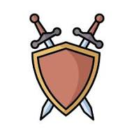

---

# Armoury 2.0



Armoury is a set of Java building blocks that more than one product needs: a utility library, a
recoverable cache, and a harness for load tests. Each one ships as its own jar, and none of them
knows about the products that use it.

**Herald and Esquire are built on it.** Herald's messaging bus runs on the queue rig and reports
through the meters in `armoury-utils`. Esquire uses all three: the entity tree is a taijitu cache,
and its load tests run on the haubergeon.

Every jar is small and does one thing. The cost is visible in each one: Micrometer and SLF4J are
the application's to provide, and the harness brings no test of its own.

---
>
> **v2.0.0 -- the first release.** The three libraries were part of Esquire until now: `utils` and
> `taijitu` in the services repository, the haubergeon in the explorer repository. They keep their
> history in the release notes. See [Release History](#release-history).

---

## Installation

Java 24 and Maven.

```
mvn clean install
```

This builds the three jars and installs them into the local Maven repository:

| Maven coordinates | What it is |
|---|---|
| `pro.mir0n:armoury-utils:2.0.0` | The utility library |
| `pro.mir0n:armoury-taijitu:2.0.0` | The taijitu cache; it depends on `armoury-utils` |
| `pro.mir0n:armoury-hauberk:2.0.0` | The haubergeon harness, also packaged as one runnable jar, `hauberk/target/armoury-hauberk.jar` |

---

## Project Structure

| Project | Description |
|---|---|
| [utils](utils) | Queues, worker pools, an expiring cache, the host identity, and the Micrometer helpers |
| [taijitu](taijitu) | A cache kept as two copies that checks itself and repairs drift |
| [hauberk](hauberk) | The haubergeon: a harness for smoke and load tests on Gatling |

---

## Release History

**[release_notes.txt](doc/release_notes.txt)** -- the release notes, newest first.

---

## Documentation

### Architecture & Design
- [Utils -- the base library](doc/Armoury.Utils.md) *(the expiring cache, the queue rig, the worker
  pool, and the host identity)*
- [Taijitu -- the recoverable cache](doc/Armoury.Taijitu.md) *(two monads behind one director, the
  night-watch sweep, the checksum, readiness, and how an application builds on it)*

### Testing
- [Haubergeon -- Gatling harness reference](doc/Armoury.Haubergeon.md) *(the command line, the
  configuration, the health check, the token refresh, and the performance matrix)*

---

## Products

<table style="width: 100%; table-layout: fixed;">
  <tr></tr>
  <tr><td style="width: 100%;">
    <table style="width: 100%; table-layout: fixed;">
      <tr></tr>
      <tr>
        <td style="width: auto; white-space: nowrap;"><b>armoury-utils</b></td>
        <td style="width: 100%;"></td>
      </tr>
    </table>
    The base library, at the bottom of the stack.
       <br> - <code>pro.mir0n.utils.concurrent</code> -- <code>ExpiringCache</code>, a cache whose entries
         expire by age: a value is stored now and picked up shortly after, or it is gone.
         <code>IQueueRig</code> and <code>BoundedQueueRig</code>, a fixed-size queue drained by one worker
         thread. <code>WorkerPool</code>, a bounded pool of workers on platform threads, on reused virtual
         threads, or on a new virtual thread per task.
       <br> - <code>pro.mir0n.utils</code> -- <code>HostId</code>, the host name of the container or pod,
         and the instance number taken from it.
       <br> - <code>pro.mir0n.o11y</code> -- three Micrometer helpers. <code>BizMeters</code> records
         business meters, <code>Gauges</code> is the one place a gauge is built, and
         <code>TraceMark</code> wraps a processing step in a span of the request trace.
       <br><br>It needs SLF4J, and it declares Micrometer at <code>provided</code> scope: the application
         brings its own Micrometer, and with it the choice of version.
  </td></tr>

  <tr><td style="width: 100%;">
    <table style="width: 100%; table-layout: fixed;">
      <tr></tr>
      <tr>
        <td style="width: auto; white-space: nowrap;"><b>armoury-taijitu</b></td>
        <td style="width: 100%;"></td>
      </tr>
    </table>
    A recoverable cache, in <code>pro.mir0n.taijitu</code>. The cache is kept as two equal copies, the
       monads, behind one director. The serving copy answers every read and receives every event. On a
       schedule, the night watch loads the second copy fresh from the source, feeds it the same events,
       and compares the two by checksum.
       <br><br>On a mismatch the director does what it is told: it logs the drift and keeps serving, it
       swaps the fresh copy in, or it stops the process so the orchestrator restarts it from a clean load.
       An event that was missed is repaired without a restart.
       <br><br>The cost is memory: the cache is held twice while the night watch runs. A single-copy
       director, <code>ATaijituRigY</code>, is there for a cache that does not need the second copy.
  </td></tr>

  <tr><td style="width: 100%;">
    <table style="width: 100%; table-layout: fixed;">
      <tr></tr>
      <tr>
        <td style="width: auto; white-space: nowrap;"><b>armoury-hauberk</b></td>
        <td style="width: 100%;"></td>
      </tr>
    </table>
    The haubergeon: a harness for smoke and load tests, built on Gatling. A mail shirt, not a full suit
       of armor. In code it goes by the shorter name, hauberk. It runs from one jar with a command line:
       <code>run</code>, <code>list</code>, <code>diff</code> and <code>summary</code>.
       <br><br>It gives every test what each test would otherwise write again: the settings from one
       properties file plus an overlay, an access token from Keycloak refreshed before it expires, a
       health check of the target before the run, a performance matrix with one CSV per scenario, and
       <code>AHauberkSimulation</code>, the base class every simulation extends.
       <br><br>The harness holds no test of its own. A product writes its simulations on top of it and
       runs them from its own tree.
  </td></tr>
</table>

---

## License

GNU General Public License v3.0. See [LICENSE](LICENSE).
